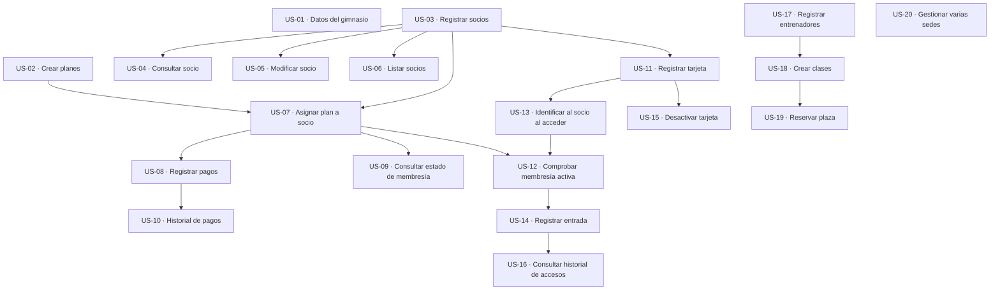

# Dependencias entre historias

> **Estado:** mapa orientativo para conversar y planificar. No implica que haya que terminar una fase completa antes de comenzar la siguiente.

## 1. Mapa sencillo

El dibujo muestra qué información o funcionalidad suele necesitar otra historia para poder integrarse. Las historias de una misma zona pueden desarrollarse en paralelo si el equipo acuerda previamente los datos que compartirán.

US-21 queda fuera del mapa hasta que el equipo aclare su relación con US-14.

## 2. Qué significa en la práctica

- Para asignar un plan a un socio (US-07), deben existir los datos del socio (US-03) y del plan (US-02).
- Para registrar un pago asociado a una contratación (US-08), debe existir la membresía creada en US-07.
- Para consultar el estado de una membresía (US-09), debe existir esa membresía.
- Para comprobar el acceso (US-12), el sistema necesita identificar al socio y conocer su membresía.
- Para consultar el historial de pagos (US-10), primero deben existir pagos registrados.
- Para reservar una clase (US-19), antes deben existir las clases y sus horarios (US-18).

## 3. Cómo trabajar en paralelo

No siempre hay que esperar a que otra persona termine toda su historia. Se puede avanzar usando un acuerdo previo sobre los datos y ejemplos de prueba.

Ejemplo: una persona desarrolla el registro de socios (US-03) y otra la consulta (US-04). Antes de empezar acuerdan qué campos tendrá un socio y qué respuesta devolverá la consulta. La persona que desarrolla US-04 puede probar su trabajo con datos ficticios mientras US-03 sigue en desarrollo.

## 4. Dependencia no significa orden obligatorio

El mapa es una simplificación funcional. Algunas relaciones son necesarias para que el sistema funcione; otras indican que una historia necesita información generada por otra. El equipo puede desarrollar tareas en paralelo y decidir el orden de integración mediante Pull Requests.

Antes de empezar cada historia, conviene acordar qué información necesita, qué crea o modifica, cómo se identifican los registros, qué respuesta se espera y cómo se probará.

## 5. Primera tanda propuesta

Se propone comenzar revisando US-01, US-02, US-03 y US-04. US-05 también es Must y debe incluirse en la planificación de la fase inicial. La selección definitiva y el reparto quedan pendientes de aprobación.
